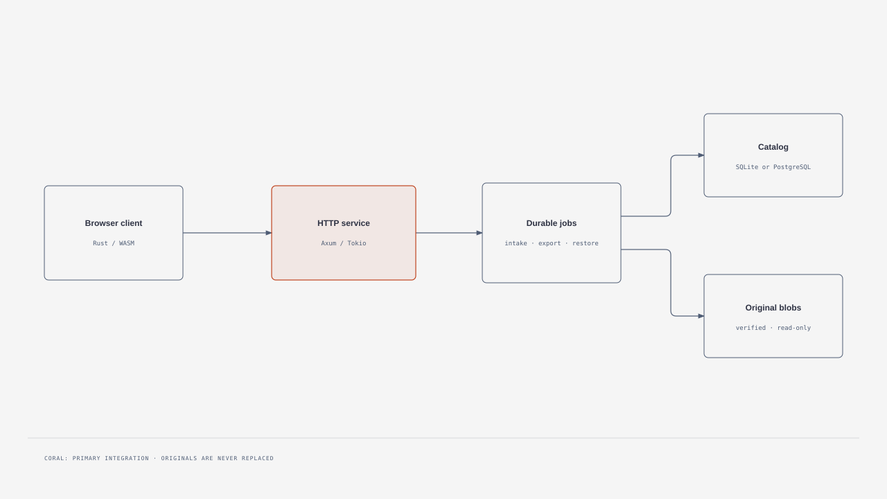
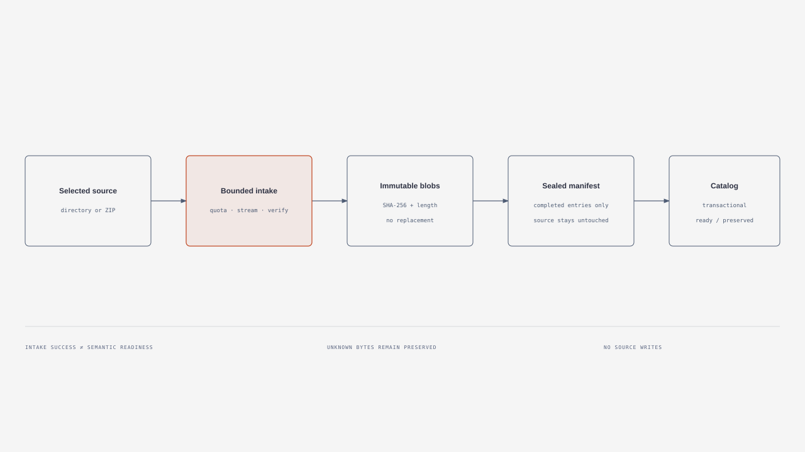
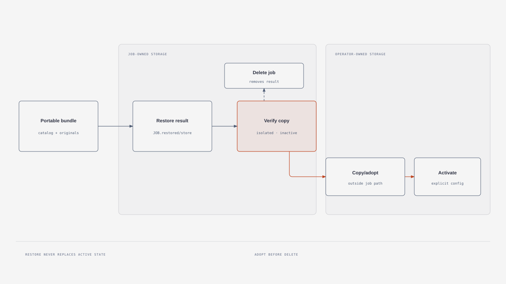

# Architecture overview

Lytronaut is a native Rust service and a Rust/WASM browser client. The service
owns durable jobs, a SQLite or PostgreSQL catalog, and immutable verified
original blobs. Optional browser WebGPU and WebCodecs paths retain CPU/static
fallbacks; no server GPU is required.

## Data flows

The browser uploads selected files or a ZIP through bounded streaming intake.
Only a sealed manifest can reach semantic catalog adaptation; source libraries
are never opened writable.

A portable restore creates a job-owned isolated copy. It never replaces active
state. Verification can be followed by cleanup, or the operator can first copy
the result outside the job-owned path and explicitly activate that copy.

Self-contained HTML sources and style provenance are in [diagrams](../diagrams/STYLE.md).
