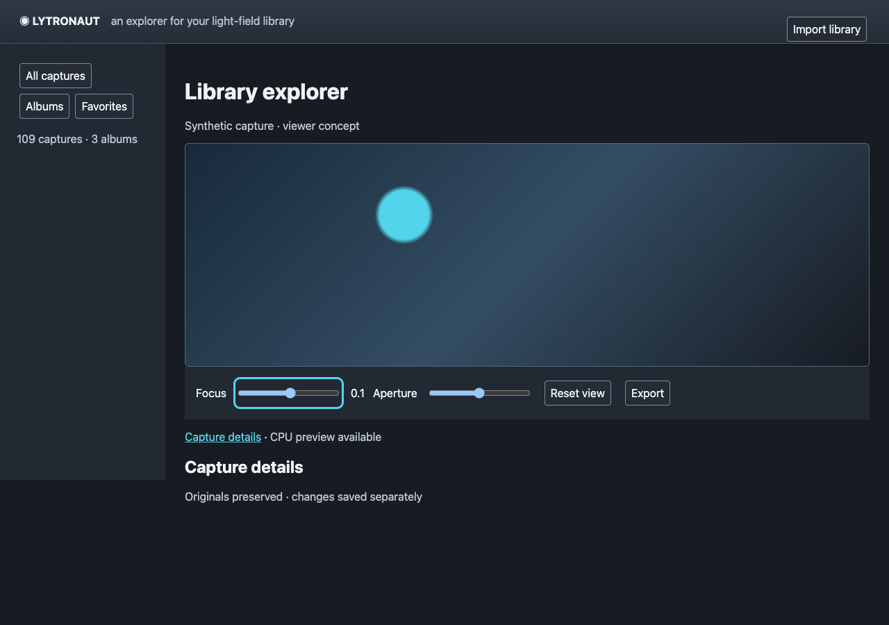

# Rust WebUI and accelerated viewer feasibility

> Historical source- and date-bound record. See the [delivered application baseline](../validation/final-main-status.md) for current status.

Evidence collected 2026-10-11. Only synthetic data was used; no personal library files were opened by this spike.

## Question

Can a Rust server and Rust/WASM WebUI support an optional accelerated viewer, retain a useful CPU path, and provide a concrete accessible mid-2010s visual direction? What can these experiments establish before native decoding and real refocus assets exist?

## Method

Disposable experiments live in `/private/tmp/lytronaut-gpu-spike`; their code is not application implementation and is not committed. Committed artifacts contain synthetic measurements and a synthetic design screenshot only. Rust 1.99.0 compiled the CPU kernel both to `wasm32-unknown-unknown` and native `aarch64-apple-darwin` with `-O`. The browser harness used puppeteer-core in an isolated Chrome profile served over localhost. Its final measurements used **no browser feature flags**.

The declared host is a MacBookPro18,1, Apple M1 Pro (10 CPU cores, 16 GPU cores), 32 GB RAM, macOS 26.6.2 build 25G83. Browser executable: Chrome **154.0.8037.98**, headless. The user agent reduces this to HeadlessChrome/154.0.0.0; it does not report the native OS accurately. `GPUAdapterInfo` reported vendor `apple`, architecture `metal-3`, `isFallbackAdapter=false`. These results therefore exercise a physical browser GPU, not SwiftShader. Headless execution does **not** measure onscreen presentation, input-to-photon latency, or mobile battery use.

The synthetic refocus-like kernel independently computes nine shifted integer views. For pixel `(x,y)`, layer `l` from 0 through 8, width `w`, and focus `f`:

```text
sx = clamp(x + (l - 4) * f, 0, w - 1)
sample = (sx * 17 + y * 31 + l * 13) mod 256
output[x,y] = floor(sum(sample for l=0..8) / 9)
```

Rust and WGSL implement the same integer formula. WGSL uses one invocation per output pixel and workgroups of 256. It generates samples algebraically, so it does **not** exercise uploaded view textures, interpolation, Bayer processing, depth reconstruction, floating-point error, color management, or the camera's real optical refocus geometry. It is a bounded compute feasibility probe, not a Lytro image-quality demonstration.

For each 512² and 1024² size, run 35 iterations with `f = iteration mod 5 - 2`; discard the first five timings. Compute the median as sorted index 15 and nearest-rank p95 as index 28 of 30 retained values. CPU timing wraps the synchronous Rust WASM export call with `performance.now()`, excluding output transfer. GPU timing wraps encoder creation, dispatch, copy to a staging buffer, submit, and `queue.onSubmittedWorkDone()`; a second measurement also includes `mapAsync`. Compare every returned integer against the Rust output across all 35 iterations. Parameter upload precedes the measured GPU interval; allocation and pipeline compilation are excluded. This asymmetry and the generated input make these indicative kernel measurements, not a complete frame benchmark. Sequential samples ran on a shared workstation without thermal isolation.

For native CPU, use the same 35/5 protocol with `Instant`, optimized native Rust, and `black_box` on an output value. The binary links no GPU API. Device loss was injected with `GPUDevice.destroy()` and observed through `device.lost`. An explicit selection-policy harness checked absent GPU and a dimension exceeding the reported limit; these are policy tests, not a finished recovery UI.

Reproduction sequence: compile the formula above to a Rust `cdylib` exporting `run`, `output`, and memory (`rustc --edition 2024 --crate-type cdylib --target wasm32-unknown-unknown -O`); implement the stated WGSL formula and protocol in a localhost browser harness; use the exact dimensions, iteration counts, timing boundaries, and rank calculation above. Original disposable source hashes and exact outputs are recorded below. Their temporary path is useful locally but is not a permanent build dependency.

## Evidence

### Candidate stack and compatibility

Select Rust Axum **0.8.9** for the server and Leptos **0.8.22** with `csr` for the client. Serve static WASM/CSS and bounded authenticated asset APIs from Axum; no SSR is needed for the initial self-hosted library. Leptos owns accessible DOM controls and state; the renderer owns a canvas. The [Axum crate](https://docs.rs/crate/axum/0.8.9) and [Leptos crate](https://docs.rs/crate/leptos/0.8.22) are the version evidence; [Leptos CSR deployment guidance](https://book.leptos.dev/deployment/csr.html) describes static client deployment.

Select wgpu **30.0.1**, WASM `default-features=false`, `webgpu` and `wgsl`, as the proposed Rust renderer binding. A `wasm-bindgen`/`web-sys` boundary obtains browser DOM/canvas objects; application logic remains Rust and WGSL is a permitted shader asset. Avoid a mandatory WebGL renderer in the first release: the portable fallback is CPU/precomputed imagery. [wgpu's crate documentation](https://docs.rs/crate/wgpu/30.0.1) describes its native and browser backends. Its compatibility remains an application integration gate, not a promise that every GPU supports every shader.

The disposable compatibility crate pins Leptos/wgpu on the WASM target and Axum on native. It compiles a Leptos `view!` function and constructs a wgpu browser instance; the native branch constructs an Axum router. This verifies dependency/API compilation only, not a shipped application or real wgpu browser rendering. The measured GPU harness uses the browser's direct WebGPU API, while the measured CPU kernel is actual Rust/WASM. End-to-end Rust/wgpu canvas rendering must still pass implementation acceptance.

Resolved browser bridge candidates are wasm-bindgen **0.2.129**, web-sys/js-sys **0.3.106** and wasm-bindgen-futures **0.4.79**. Record lockfiles and pin the matching wasm-bindgen CLI during implementation; do not independently upgrade the CLI ahead of the resolved crate. References: [wasm-bindgen crate](https://docs.rs/crate/wasm-bindgen/0.2.129), [web-sys crate](https://docs.rs/crate/web-sys/0.3.106). Compilation result is recorded under the final validation note.

The downloaded crate manifests declare MSRVs Axum 1.80, Leptos 1.88, wgpu 1.87.0 and wasm-bindgen/web-sys 1.81, all below the pinned Rust 1.99.0. Axum/Leptos declare MIT; wgpu and the browser bridge declare MIT OR Apache-2.0. Choose the MIT option where applicable and retain required dependency notices. This checks direct candidates, not a complete transitive license audit of a future product lockfile.

### Actual measurements

[Machine-readable results](assets/gpu-measurements.json) preserve raw summary values. Timings below are milliseconds, rounded for readability.

| Output | Rust/WASM CPU median / p95 | WebGPU completion median / p95 | WebGPU including mapped readback median / p95 | Native Rust CPU median / p95 |
| --- | --- | --- | --- | --- |
| 512 × 512 | 1.60 / 1.70 | 0.80 / 1.00 | 1.00 / 1.20 | 0.520 / 0.618 |
| 1024 × 1024 | 6.20 / 6.50 | 1.20 / 2.20 | 1.40 / 2.40 | 2.104 / 2.378 |

At 1024², GPU completion was approximately 5.2× faster than the WASM CPU kernel, or 4.4× including mapped readback. Native CPU was faster than WASM CPU on this host. The comparison supports keeping both paths; it does not establish production frame rate.

Maximum absolute error **0**, RMSE **0** at both sizes across all 35 comparisons. No uncaptured GPU errors. Explicit GPU allocations: output + staging + 16-byte uniform = **2,097,168 bytes** at 512² and **8,388,624 bytes** at 1024². Rust WASM linear memory was **5,308,416 bytes** at both sizes (a fixed 1024² output array plus runtime memory). Module download was **1,656,496 bytes**, uncompressed, and includes compiler/runtime overhead. These are measured allocated sizes, **not** total browser RSS, driver residency, or peak JavaScript heap. Those totals remain unmeasured.

Adapter limits observed: 2D texture dimension **16,384**, storage-buffer binding **4,294,967,292 bytes**. The experiment requested default device limits; production must inspect the actual **device** limits and apply smaller application caps rather than trusting adapter maxima. Destruction produced loss reason `destroyed`; the policy selected CPU for absence and destruction and rejected a width of 16,385. Real driver reset, GPU process crash, suspension/resume, leak-free renderer replacement, and repeated recovery remain unverified.

Disposable source SHA-256:

```text
CPU source:     4c16fa00a32ac390db5473c540247634fc33069ba581a5f32504b9730ac8783f
CPU WASM:       e422dbeee8e3d0bee766b275ee38ad911194e48c298c1efbd0159bd46af35d64
Browser bench:  47a1695e55d59f274905c995043c03bde63f13e4845e7d2c0c6d9fa4d9a7a7e3
Visual concept: c2dca12d3131cee701abf1872e4d23197ee39153ef0ce0e39baca8ee838d6812
```

### Visual concept and accessibility checks



The direction is a photo-workstation aesthetic: a restrained graphite shell, shallow beveled gradient header, 238-pixel album rail, generously framed image stage, persistent control strip, subtle 4–6-pixel radii, cyan links/selection/focus, and system sans-serif typography. Keep image pixels visually dominant. Import and export are plainly labeled; view edits are separated from original capture details. The concept uses an abstract generated gradient, not a personal photograph. The screenshot is a **design artifact**, not implemented product behavior.

The disposable DOM used semantic buttons, labeled native ranges, a named library nav, a synthetic image description, a numeric focus output, and a details link. In Chrome, nine successive Tab presses reached Import, All captures, Albums, Favorites, Focus, Aperture, Reset, Export, and Capture details, each with a 3-pixel focus outline after refinement. ArrowRight changed focus from 0 to 0.1. Emulating `prefers-reduced-motion: reduce` yielded matching media query, `transition-duration: 0s`, and `animation-name: none`. [Keyboard and motion evidence](assets/gpu-accessibility.json) records these results. No screen-reader audit, touch/mobile test, high-contrast forced-colors test, or 200% zoom audit was performed; these are implementation acceptance items.

Calculated sRGB contrast `(lighter luminance + .05)/(darker + .05)`:

| Foreground / background | Ratio | Intended use |
| --- | --- | --- |
| `#eef3f8` / `#171b22` | 15.47:1 | Main text |
| `#b8c4d2` / `#222933` | 8.28:1 | Secondary text |
| `#52d5eb` / `#252c36` | 8.09:1 | Cyan focus and links |
| `#eef3f8` / `#252c36` | 12.61:1 | Button text |
| `#7d8b9b` / `#252c36` | 4.05:1 | Control borders |

These selected pairs exceed the usual 4.5:1 normal-text and 3:1 non-text thresholds respectively; they do not prove conformance of the whole UI. See [W3C contrast guidance](https://www.w3.org/WAI/WCAG22/Understanding/contrast-minimum.html) and [non-text contrast guidance](https://www.w3.org/WAI/WCAG22/Understanding/non-text-contrast.html).

## Verdict

**GO** for a Rust Axum/Leptos client architecture with a server CPU baseline and an optional browser WebGPU enhancement. The measured synthetic kernel demonstrates physical browser acceleration and exact integer CPU/GPU agreement on this host. **NO-GO for promising production interactive raw refocus, measured end-to-end frame latency, or cross-browser parity from this experiment alone.** Those claims require calibrated assets and a Rust/wgpu viewer integration benchmark.

| Capability / platform | Status |
| --- | --- |
| Chrome 154, macOS M1 Pro: synthetic Rust/WASM CPU and direct WebGPU compute | Measured GO |
| Rust/WASM Leptos + wgpu API dependency compilation | Compilation evidence; runtime integration still gated |
| Native macOS CPU kernel, no GPU dependency | Measured GO; full server operation still gated |
| Safari, Firefox, iOS, Android, Windows and Linux clients | Unverified |
| Linux amd64/arm64 server and CPU decode under container limits | Unverified; required before release |
| Native wgpu renderer or WebGL2 renderer | Unmeasured; not required for the baseline |
| Real calibrated Lytro refocus and floating-point/color quality | Unverified; decoding spike and fixtures are prerequisites |

## Recommendation

Ship browsing and processed previews first. Keep the initial native server independent of GPUs, browser APIs and renderer dependencies through target-specific crates/features. Run expensive CPU processing in bounded jobs; test a Linux container without GPU devices before claiming self-hostability. Browser code selects WebGPU only after successful adapter/device acquisition, supported formats/limits and pipeline creation. On missing API/adapter, rejected device, validation failure or loss, cancel the renderer generation, release its resources, retain the last valid frame and controls, and switch to a CPU worker or authenticated precomputed preview. Offer an explicit retry rather than repeatedly acquiring a broken device. An unsupported raw asset must produce a useful preserved-original status instead of a fake rendered result.

Use a versioned authenticated manifest with immutable content-hash asset identifiers, dimensions, pixel format/color space, layer count, representation, encoded and decoded byte counts, and checked chunk offsets. Do not expose source paths or serials. Fetch at most two bounded chunks concurrently; verify bytes against the manifest; reject arithmetic overflow, impossible extents, excess layers and decompression expansion before allocation. Prefer progressive thumbnails and ≤1024² interactive assets; serve tiled/downsampled alternatives for originals exceeding caps. Never upload full sensor mosaics merely to display a thumbnail. Cross-origin restrictions and secure-context HTTPS are deployment requirements for browser GPU use.

Proposed acceptance budgets, **targets rather than measured product results**:

| Boundary | Initial target |
| --- | --- |
| Preview dimensions | ≤1024 × 1024; hard decoded representation cap 2048 × 2048, then tile/downsample |
| Layers | ≤9 resident RGBA8 views for the first renderer; 36 MiB at 1024² |
| Explicit renderer allocation | ≤64 MiB GPU, ≤96 MiB CPU/WASM working set per viewer; count staging and intermediates |
| Asset chunks and transfer | ≤8 MiB per chunk; ≤48 MiB encoded viewer asset, two in flight; manifest ≤256 KiB |
| Warm GPU interaction | p95 submit-to-present ≤16.7 ms on the declared desktop reference hardware, with actual uploaded textures |
| CPU interaction | p95 ≤100 ms at ≤512² or precomputed planes; debounce/coalesce to one queued update |
| Correctness | Integer path exact; color float pipeline ≤1 output 8-bit code maximum error and RMSE ≤0.5 against the CPU reference on defined fixtures |
| Loss/absence | No uncaught rejection, original controls stay usable, fallback indication ≤1 second after observed loss; no asset re-import |
| Accessibility | Full keyboard operation, visible focus, meaningful range values, 4.5:1 text/3:1 controls, 200% zoom, screen-reader/forced-colors check; motion preference honored |

WebGPU compute completion is not presentation timing: measure `requestAnimationFrame`/submitted frame latency in the actual Rust viewer before accepting the 16.7 ms goal. Browser memory API totals may be unavailable; report counted allocations separately from measured process/heap/residency figures. If 9 layers fail budgets, reduce resolution/resident views and retain the preview baseline. Rust WebGL2 can be reconsidered after supported browser evidence justifies maintaining another rendering path.

Final validation note: both disposable compatibility checks passed: WASM Leptos 0.8.22 + wgpu 30.0.1, and native Axum 0.8.9, using Rust 1.99.0. The initial probe used an older wgpu constructor signature and failed; adapting it to wgpu 30's owned `InstanceDescriptor::new_without_display_handle()` API produced the passing result. This illustrates why implementation should follow version-pinned examples rather than stale snippets. Repository validation uses `bh work check GPU research` (mise-pinned `just check`); committed changes are documentation/evidence only.
